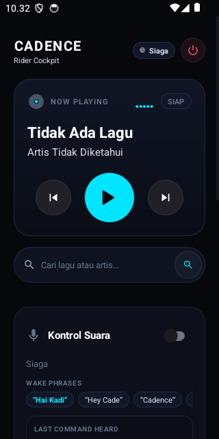
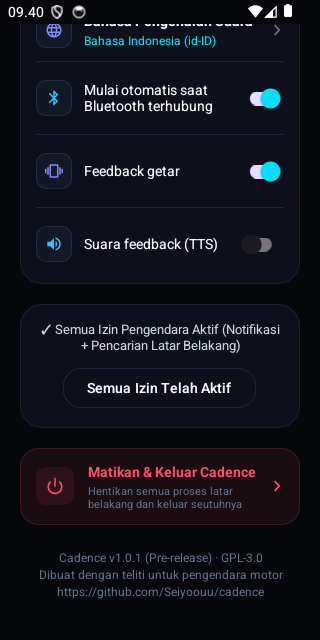

<div align="center">

# 🏍️ Cadence

### Pengendali Suara Hands-Free untuk YouTube Music Morphe &amp; ReVanced
*Dirancang khusus untuk pengendara motor dengan helm, interkom Bluetooth, dan sarung tangan.*

[](https://github.com/Seiyoouu/cadence/actions/workflows/build.yml)
[](https://github.com/Seiyoouu/cadence/releases)
[](https://developer.android.com)
[](https://github.com/Seiyoouu/cadence)
[](LICENSE)

<br/>

<p align="center">
  
  
</p>

<p align="center">
  <strong><a href="README.id.md">Bahasa Indonesia</a></strong> · <strong><a href="README.md">English</a></strong>
</p>

</div>

---

## ⚡ Dilema Pengendara di Kecepatan 60 km/jam

Mengganti lagu atau mencari musik saat berkendara di jalan raya adalah hal yang merepotkan dan berbahaya:
- ❌ **Harus menepi** ke bahu jalan yang ramai hanya untuk mengganti lagu.
- ❌ **Membuka sarung tangan tebal** dengan tangan berkeringat di bawah terik matahari.
- ❌ **Menatap tombol layar sentuh kecil** melalui kaca helm yang silau.

### 🛡️ Solusi Cadence
Biarkan ponsel **tetap tersimpan aman di dalam saku jaket**. Bicaralah secara santai melalui mikrofon interkom helm atau earbud TWS Anda. Cadence mengeksekusi kontrol pemutaran, pencarian judul lagu, dan antrean musik **tanpa sentuhan layar** dan **tanpa gangguan fokus**.

```text
Pengendara: "Hai Kadi, putar Dewa 19 Kangen"
└── 📳 Helm bergetar 2 kali sebagai konfirmasi fisik
└── 🎵 Musik langsung berputar otomatis di YouTube Music Morphe
└── 🏍️ Kedua tangan tetap aman memegang stang motor
```

---

## ✨ Kemampuan Utama

| Fitur Unggulan | Mekanisme Teknis | Pengalaman Pengendara |
|:---|:---|:---|
| **Eksekusi di Saku &amp; Layar Mati** | Foreground Service dengan `PARTIAL_WAKE_LOCK` serta tipe `microphone` + `connectedDevice`. | Terus aktif tanpa terbunuh oleh sistem penghemat baterai agresif bawaan HP Android. |
| **Aman Saat Nyanyi &amp; Ngobrol** | Model kata kunci akustik majemuk (`Hai Kadi`, `Hey Cade`, `Cadence`) dengan filter batas kata. | **0% False Trigger.** Bebas bernyanyi mengikuti lagu atau mengobrol santai tanpa takut musik tiba-tiba terputus atau pause sendiri. |
| **Proteksi Otomatisasi Play (Auto-Resume)** | Pelacak status cerdas (`wasPlayingBeforeWake`). | Jika desau angin kencang menyebabkan perintah suara tidak terdeteksi, musik otomatis langsung berputar kembali tanpa jeda. |
| **Pencarian Lagu Bahasa Alami** | Resolusi kueri terdesentralisasi via REST API Piped &amp; Invidious langsung ke deep link YouTube Music. | Cukup sebutkan judul lagu atau artis langsung (misal *"Dewa 19 Kangen"*, *"Sheila On 7 Dan"*, *"Coldplay Yellow"*), dengan atau tanpa kata *"putar"*. |
| **1-Tap Matikan Total (Cockpit Quit)** | Dual emergency control (Ikon Power di Header atas + Kartu Matikan di bawah). | Matikan `VoiceService`, lepas kunci wakelock audio, dan bunuh total proses latar belakang dalam 1 ketukan bersih. |
| **Otomatisasi Bluetooth Cerdas** | Reactive BroadcastReceiver memantau profil A2DP &amp; Headset. | Suara otomatis aktif saat interkom helm terhubung, dan langsung tertidur saat sambungan terputus guna menghemat daya. |
| **Umpan Balik Haptic Helm** | Pola gelombang getaran presisi (`VibrationEffect`). | Memberikan getaran konfirmasi fisik yang jelas di saku jaket sehingga Anda tahu perintah berhasil tanpa perlu melihat HP. |
| **100% Arsitektur Rootless** | IPC resmi Android via `MediaSession` dan `NotificationListenerService`. | Tanpa root, Magisk, atau KernelSU. Kompatibel penuh dengan Morphe, ReVanced, dan Google YTM resmi. |

---

## 🗣️ Perintah Suara yang Didukung

### 🔑 Kata Panggil (Sapaan Majemuk Terarah)
Cadence mendengarkan sapaan majemuk yang disengaja agar obrolan biasa atau lirik lagu tidak memicu pengenalan:
* **`“Hai Kadi”`** / **`“Halo Kadi”`** / **`“Hey Kadi”`** / **`“Oke Kadi”`**
* **`“Hey Cade”`** / **`“Hai Cade”`** / **`“Halo Cade”`**
* **`“Cadence”`** / **`“Hai Cadence”`**

---

### 🎵 Lembar Pintasan Kontrol &amp; Pencarian
Mendukung perintah **Bahasa Indonesia** dan **Bahasa Inggris** secara bersamaan:

```text
Kontrol Pemutaran:
├── ⏭️ Lagu Berikutnya : "next", "skip", "lagu berikutnya", "ganti lagu", "selanjutnya"
├── ⏮️ Lagu Sebelumnya : "previous", "prev", "back", "lagu sebelumnya", "kembali", "ulang"
├── ⏸️ Jeda / Berhenti : "pause", "stop", "jeda", "berhenti", "matikan"
├── ▶️ Lanjutkan / Play: "play", "resume", "lanjut", "mainkan", "putar"
└── 🔍 Cari Langsung   : Cukup sebutkan judul lagu atau artis:
                         • "Dewa 19 Kangen"
                         • "Sheila On 7 Dan"
                         • "Coldplay Yellow"
                         • "Putar lagu Komang"
                         • "Play Bohemian Rhapsody"
```

---

## 🏗️ Arsitektur Sistem

```text
┌─────────────────────────────────────────────────────────────┐
│               INTERKOM HELM BLUETOOTH / TWS                 │
│             Sena • Cardo • FreedConn • AirDots              │
└──────────────────────────────┬──────────────────────────────┘
                               │ Aliran Audio 16kHz PCM
                               ▼
┌─────────────────────────────────────────────────────────────┐
│                 ENGINE WAKE WORD (Offline)                  │
│    Model Akustik VOSK Kaldi di RAM (assets/model-en/)       │
│    Latensi: <10ms respons instan | Hemat baterai 100%       │
└──────────────────────────────┬──────────────────────────────┘
                               │ Kata panggil terkonfirmasi + Getar Haptic
                               ▼
┌─────────────────────────────────────────────────────────────┐
│                 STT PERINTAH (Android Native)               │
│    Multi-Hypothesis SpeechRecognizer (id-ID + en-US)        │
│    Mengekstrak 5 Alternatif Tebakan Suara                   │
└──────────────────────────────┬──────────────────────────────┘
                               │ Array Hipotesis Teks
                               ▼
┌─────────────────────────────────────────────────────────────┐
│                 PARSER PERINTAH BILINGUAL                   │
│    Evaluasi multi-pass regex frasa alami Indonesia & Inggris│
└───────────────┬─────────────────────────────┬───────────────┘
                │                             │
       [Perintah Transport]           [Kueri Pencarian]
                │                             │
                ▼                             ▼
┌──────────────────────────────┐ ┌────────────────────────────┐
│       TRANSPORT ENGINE       │ │    SEARCH & PLAY ENGINE    │
│   MediaSession / Controller  │ │   Piped/Invidious REST API │
│   Play / Pause / Next / Prev │ │   Deep link auto-play      │
└───────────────┬──────────────┘ └────────────┬───────────────┘
                │                             │
                └──────────────┬──────────────┘
                               ▼
┌─────────────────────────────────────────────────────────────┐
│             YOUTUBE MUSIC MORPHE / REVANCED                 │
│         Berputar di latar belakang saat HP di saku          │
└─────────────────────────────────────────────────────────────┘
```

---

## 🚀 Panduan Instalasi &amp; Sideloading

### 1. Unduh File APK
Ambil rilis terbaru dari halaman [GitHub Releases](https://github.com/Seiyoouu/cadence/releases/tag/v1.0.1):
* 📦 **File APK**: **`Cadence-v1.0.1.apk`** (99 MB)

> 💡 **Memperbarui dari versi uji lama?**  
> Jika muncul pesan *"Aplikasi tidak terinstal karena paket tampaknya tidak valid"*, cukup **Hapus/Uninstall Cadence lama** terlebih dahulu dari HP Anda, lalu pasang `Cadence-v1.0.1.apk`. Instalasi dijamin langsung lancar!

---

### 2. Panduan Sideloading

#### 🛡️ Google Play Protect (Metode Jeda 24 Jam)
Karena Cadence meminta izin mikrofon latar belakang dan akses notifikasi di luar Play Store, Play Protect mungkin memunculkan dialog verifikasi:
1. Buka **Google Play Store > Foto Profil > Play Protect > Ikon Gerigi (Pengaturan)**.
2. Matikan toggle *"Pindai aplikasi dengan Play Protect"* lalu pilih **"Jeda selama 24 jam"**.
3. Pasang APK Cadence dan buka aplikasinya.

#### 🔓 Android 13+ Setelan yang Dibatasi (Restricted Settings)
Android 13+ membatasi izin sensitif untuk aplikasi yang diinstal di luar toko resmi:
1. Buka menu **Setelan HP > Aplikasi > Cadence**.
2. Ketuk **menu titik tiga (⋮)** di pojok kanan atas layar.
3. Pilih **"Izinkan setelan yang dibatasi"** dan konfirmasi kunci layar Anda.
4. Kembali ke Cadence dan aktifkan Akses Notifikasi melalui panduan onboarding.

#### 🪟 Pencarian Musik di Latar Belakang (Tampil di Atas Aplikasi Lain)
Android 10 ke atas membatasi aplikasi di latar belakang untuk membuka player musik secara otomatis. Izinkan *"Tampil di atas aplikasi lain"* saat diminta pada panduan onboarding agar pencarian lagu dapat langsung berputar meskipun HP terkunci di saku jaket.

---

## 🛠️ Kompilasi dari Sumber (Build)

Prasyarat: JDK 17 dan Android SDK Platform 34.

```bash
# Clone repository
git clone https://github.com/Seiyoouu/cadence.git
cd cadence

# Build APK release bertanda tangan
./gradlew assembleRelease
```

File APK rilis akan dihasilkan di:
`app/build/outputs/apk/release/Cadence-v1.0.1.apk`

---

## 🔒 Privasi &amp; Transparansi

* **100% Deteksi Suara Lokal**: Pemrosesan suara berlangsung seutuhnya di RAM ponsel via model offline VOSK. Tidak ada rekaman suara yang dikirimkan ke server luar mana pun.
* **Tanpa Akun Google**: Cadence 100% rootless dan tidak pernah meminta atau mengakses kredensial akun Google Anda.
* **Tanpa Pelacak (Zero Telemetry)**: Tanpa analitik, tanpa pelacak aktivitas, tanpa cookies, dan tanpa iklan pihak ketiga.

---

## 📜 Lisensi

Cadence adalah perangkat lunak sumber terbuka yang didistribusikan di bawah lisensi [GNU General Public License v3.0](LICENSE).
Dibuat dengan dedikasi untuk komunitas pengendara motor di mana pun berada.
