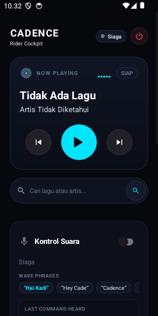
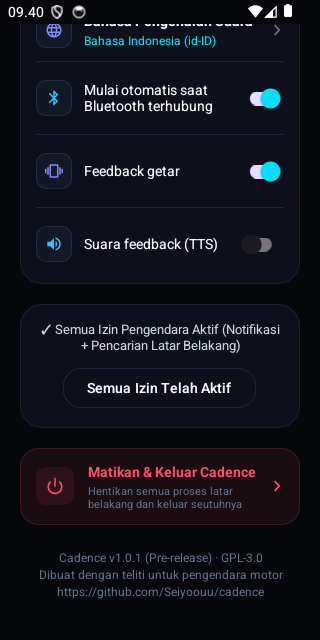

<div align="center">

# 🏍️ Cadence

### Hands-Free Voice Cockpit for YouTube Music Morphe &amp; ReVanced
*Engineered for motorcycle riders wearing helmets, Bluetooth intercoms, and riding gloves.*

[](https://github.com/Seiyoouu/cadence/actions/workflows/build.yml)
[](https://github.com/Seiyoouu/cadence/releases)
[](https://developer.android.com)
[](https://github.com/Seiyoouu/cadence)
[](LICENSE)

<br/>

<p align="center">
  
  
</p>

<p align="center">
  <strong><a href="README.md">English</a></strong> · <strong><a href="README.id.md">Bahasa Indonesia</a></strong>
</p>

</div>

---

## ⚡ The 60 km/h Problem

Changing tracks or searching for songs while cruising on a motorcycle is a nightmare:
- ❌ **Pulling over** onto a dangerous road shoulder just to change a playlist.
- ❌ **Taking off tight riding gloves** with sweaty hands under the hot sun.
- ❌ **Squinting at tiny touchscreen buttons** through helmet visors and glare.

### 🛡️ The Cadence Solution
Keep your phone **locked deep inside your jacket pocket**. Speak naturally into your helmet microphone or TWS earbuds. Cadence handles playback, song searches, and queueing with **zero screen contact** and **zero distraction**.

```text
Rider: "Hai Kadi, putar Dewa 19 Kangen"
└── 📳 Helmet gives 2 distinct vibration pulses
└── 🎵 Music starts streaming immediately into YouTube Music Morphe
└── 🏍️ Your hands never left the handlebars
```

---

## ✨ Cutting-Edge Capabilities

| Feature | Engineering Behind It | Rider Experience |
|:---|:---|:---|
| **Pocket &amp; Screen-Off Engine** | Foreground Service with `PARTIAL_WAKE_LOCK` and dual `microphone` + `connectedDevice` flags. | Works continuously while phone stays locked in your pocket. Will not get killed by OEM battery savers. |
| **On-Demand Helmet Mic Routing** | Dynamic Bluetooth SCO communication routing via `AudioManager.setCommunicationDevice` (API 31+). | Automatically engages your helmet TWS microphone *only* during the 2–3s command window, keeping music 100% crystal-clear A2DP HD stereo 24/7! |
| **Singing &amp; Chatter Safe** | Strict compound acoustic wake model (`Hai Kadi`, `Hey Cade`, `Cadence`) with word-boundary debouncing. | **Zero false triggers.** Sing along to lyrics or chat with friends without music suddenly pausing or cutting out. |
| **Auto-Resume Protection** | Intelligent state tracker (`wasPlayingBeforeWake`). | If ambient highway wind noise causes a command timeout, your music immediately resumes playing automatically. |
| **Direct Natural Song Search** | Decoupled query resolution via Piped &amp; Invidious REST APIs straight into YouTube Music deep links. | Simply say any title or artist directly (e.g. *"Dewa 19 Kangen"* or *"Coldplay Yellow"*), with or without saying *"play"*. |
| **Instant 1-Tap Cockpit Quit** | Dual emergency shutdown controls (Header Power icon + Bottom Shutdown Card). | Terminate `VoiceService`, release audio wakelocks, and kill all background processes in one clean click. |
| **Smart Bluetooth Automation** | Reactive BroadcastReceiver monitoring A2DP &amp; Headset state. | Listening activates automatically when your helmet intercom connects, and suspends when disconnected. |
| **Tactile Helmet Haptics** | Precise vibration waveform patterns (`VibrationEffect`). | Distinct physical confirmation pulses inside your pocket so you know your command was heard without looking. |
| **100% Rootless Architecture** | Pure Android IPC via `MediaSession` and `NotificationListenerService`. | No Magisk, no KernelSU, no Xposed required. Fully compatible with Morphe, ReVanced, and Google YTM. |

---

## 🗣️ Supported Voice Commands

### 🔑 Wake Words (Strict Compound Greetings)
Cadence listens for clear, deliberate compound phrases so that accidental noise or singing never triggers recognition:
* **`“Hai Kadi”`** / **`“Halo Kadi”`** / **`“Hey Kadi”`** / **`“Oke Kadi”`**
* **`“Hey Cade”`** / **`“Hai Cade”`** / **`“Halo Cade”`**
* **`“Cadence”`** / **`“Hai Cadence”`**

---

### 🎵 Playback &amp; Song Search Cheatsheet
Both **Bahasa Indonesia** and **English** commands are parsed simultaneously:

```text
Media Playback:
├── ⏭️ Next Track     : "next", "skip", "lagu berikutnya", "ganti lagu", "selanjutnya"
├── ⏮️ Previous Track : "previous", "prev", "back", "lagu sebelumnya", "kembali", "ulang"
├── ⏸️ Pause / Stop   : "pause", "stop", "jeda", "berhenti", "matikan"
├── ▶️ Resume / Play  : "play", "resume", "lanjut", "mainkan", "putar"
└── 🔍 Instant Search : Speak song title or artist directly:
                        • "Dewa 19 Kangen"
                        • "Sheila On 7 Dan"
                        • "Coldplay Yellow"
                        • "Putar lagu Komang"
                        • "Play Bohemian Rhapsody"
```

---

## 🏗️ System Architecture

```text
┌─────────────────────────────────────────────────────────────┐
│              BLUETOOTH HELMET INTERCOM / TWS                │
│             Sena • Cardo • FreedConn • AirDots              │
└──────────────────────────────┬──────────────────────────────┘
                               │ 16kHz PCM Audio Stream
                               ▼
┌─────────────────────────────────────────────────────────────┐
│                 WAKE WORD ENGINE (Offline)                  │
│    Memory-Cached VOSK Acoustic Model (assets/model-en/)     │
│    Latency: <10ms warm detection | Zero CPU battery waste   │
└──────────────────────────────┬──────────────────────────────┘
                               │ Wake confirmed + Tactile Haptic Pulse
                               ▼
┌─────────────────────────────────────────────────────────────┐
│                 COMMAND STT (Android Native)                │
│    Multi-Hypothesis SpeechRecognizer (id-ID + en-US)        │
│    Extracts Top-5 Recognition Candidates                    │
└──────────────────────────────┬──────────────────────────────┘
                               │ Hypothesis Candidate Array
                               ▼
┌─────────────────────────────────────────────────────────────┐
│                 BILINGUAL COMMAND PARSER                    │
│    Multi-pass regex parser with Indonesian natural matching │
└───────────────┬─────────────────────────────┬───────────────┘
                │                             │
       [Transport Command]             [Music Query]
                │                             │
                ▼                             ▼
┌──────────────────────────────┐ ┌────────────────────────────┐
│       TRANSPORT ENGINE       │ │   SEARCH & PLAY ENGINE     │
│   MediaSession / Controller  │ │   Piped/Invidious REST API │
│   Play / Pause / Next / Prev │ │   Deep link auto-play      │
└───────────────┬──────────────┘ └────────────┬───────────────┘
                │                             │
                └──────────────┬──────────────┘
                               ▼
┌─────────────────────────────────────────────────────────────┐
│             YOUTUBE MUSIC MORPHE / REVANCED                 │
│      Plays in background while phone is locked in pocket    │
└─────────────────────────────────────────────────────────────┘
```

---

## 🚀 Installation &amp; Sideloading

### 1. Download Binary
Grab the latest release from the [GitHub Releases](https://github.com/Seiyoouu/cadence/releases/tag/v1.0.2) page:
* 📦 **Asset**: **`Cadence-v1.0.2.apk`** (99 MB)

> 💡 **Upgrading from older test builds?**  
> If Android displays *"App not installed as package appears to be invalid"*, simply **uninstall (hapus instalan)** the older version first, then install `Cadence-v1.0.2.apk`. It will install seamlessly!

---

### 2. Sideloading Guidance

#### 🛡️ Google Play Protect (The 24-Hour Pause)
Because Cadence requests background microphone and notification access outside Google Play Store, Play Protect may prompt an unverified warning.
1. Open **Google Play Store > Profile Icon > Play Protect > Gear Icon (Settings)**.
2. Toggle off *"Scan apps with Play Protect"* and select **"Pause for 24 hours"**.
3. Install the Cadence APK and launch it.

#### 🔓 Android 13+ Restricted Settings
Android 13+ restricts sensitive permissions on sideloaded APKs:
1. Open phone **Settings > Apps > Cadence**.
2. Tap the **three-dot menu (⋮)** in the top right corner.
3. Tap **"Allow restricted settings"** and confirm your screen lock.
4. Return to Cadence and complete the onboarding setup.

#### 🪟 Background Music Search (Display Over Other Apps)
Android 10+ prevents background services from launching media players directly. Grant the *"Display over other apps"* permission when prompted during onboarding so voice queries can open and play songs while your phone is locked in your jacket.

---

## 🛠️ Building from Source

Prerequisites: JDK 17 and Android SDK Platform 34.

```bash
# Clone the repository
git clone https://github.com/Seiyoouu/cadence.git
cd cadence

# Build signed release APK
./gradlew assembleRelease
```

The APK binary will be output at:
`app/build/outputs/apk/release/Cadence-v1.0.2.apk`

---

## 🔒 Privacy &amp; Transparency

* **100% On-Device Wake Detection**: Audio is processed strictly locally inside RAM using the offline VOSK model. No voice streams are ever transmitted to any external server.
* **No Account Required**: Cadence is 100% rootless and never asks for, touches, or stores your Google account credentials.
* **Zero Telemetry**: No analytics, no crashlytics, no tracking cookies, and zero third-party advertising SDKs.

---

## 📜 License

Cadence is free and open-source software distributed under the [GNU General Public License v3.0](LICENSE).
Crafted with passion for motorcycle riders worldwide.
