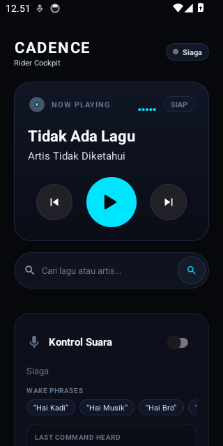

[English](README.md) · [Bahasa Indonesia](README.id.md)

# Cadence

> Hands-free voice controller for YouTube Music Morphe, engineered for motorcycle riders with helmet Bluetooth intercoms and TWS earbuds.

[](https://github.com/Seiyoouu/cadence/actions/workflows/build.yml)
[](https://github.com/Seiyoouu/cadence/releases)
[](https://developer.android.com)
[](LICENSE)

<p align="center">
  
</p>

---

## Overview

Changing tracks or searching for music while riding a motorcycle is inherently hazardous. Riders are forced to pull over onto the shoulder, remove heavy riding gloves, unlock their smartphone in direct sunlight, and navigate small touchscreen controls.

**Cadence** eliminates physical interaction entirely. Keep your phone locked in your jacket pocket, speak into your helmet microphone, and manage playback with zero screen contact.

---

## Core Capabilities

| Capability | Technical Mechanism | Benefit |
|:---|:---|:---|
| **Pocket & Screen-Off Execution** | Foreground service with `PARTIAL_WAKE_LOCK` and dual `microphone` + `connectedDevice` service types. | Runs continuously with the screen off and phone locked in pockets without OS throttling. |
| **Bilingual Voice Engine** | Hybrid stack: Memory-cached VOSK Kaldi acoustic model for wake words paired with Android native `SpeechRecognizer` for command parsing. | Understands English and Bahasa Indonesia simultaneously with low latency (<10ms wake reaction). |
| **Natural Song Search** | Decoupled query resolution via Piped & Invidious REST endpoints directly into YouTube Music deep links. | Simply speak any title or artist directly (e.g. *"Dewa 19 Kangen"* or *"Coldplay Yellow"*), with or without saying *"play"*. |
| **Bluetooth Rider Mode** | Reactive BroadcastReceiver monitoring A2DP / Headset connection state changes. | Automatically starts listening when your helmet headset connects, and suspends immediately on disconnect to conserve battery. |
| **Tactile Helmet Haptics** | Precision vibration waveforms (`Vibrator` / `VibrationEffect`). | Provides distinct physical confirmation pulses inside your pocket when wake words and commands resolve. |
| **Physical Button Fallback** | Hardware `MEDIA_BUTTON` intent routing. | Physical TWS media buttons remain instant transport fallbacks during high-speed highway wind noise. |
| **100% Rootless Architecture** | Direct IPC via Android `MediaSession` and `NotificationListenerService`. | Zero root, Magisk, or Xposed dependencies. Interacts cleanly with both Morphe and ReVanced packages. |

---

## System Requirements

- **Android OS**: Android 8.0 (API level 26) or higher.
- **Companion Player**: [YouTube Music Morphe](https://morphe.software) (`app.morphe.android.apps.youtube.music`), ReVanced, or Google stock YTM.
- **Speech Provider**: Google App / Android Speech Services (bundled on 99% of Android devices).
- **Audio Gear**: Helmet Bluetooth intercom (Sena, Cardo, FreedConn) or in-ear TWS earbuds with microphone.

---

## Supported Voice Commands

### Wake Words
Cadence uses compound greetings to eliminate false positives during casual conversation:
- `"Hai Kadi"` / `"Halo Kadi"` / `"Hey Kadi"` / `"Oke Kadi"`
- `"Hai Musik"` / `"Halo Musik"`
- `"Hai Bro"` / `"Halo Bro"`
- `"Hai Cade"` / `"Hey Cade"` / `"Halo Cade"`
- `"Cadence"`

### Media Transport & Search
```text
Playback Controls:
├── Next Track     : "next", "skip", "lagu berikutnya", "ganti lagu", "selanjutnya"
├── Previous Track : "previous", "prev", "back", "lagu sebelumnya", "kembali"
├── Pause / Stop   : "pause", "stop", "jeda", "berhenti", "matikan"
├── Resume         : "play", "resume", "lanjut", "mainkan", "putar"
└── Direct Search  : Just name the song or artist:
                     • "Dewa 19 Kangen"
                     • "Sheila On 7 Dan"
                     • "Coldplay Yellow"
                     • "Putar lagu Komang"
```

---

## Architecture

```text
┌─────────────────────────────────────────────────────────────┐
│                      HELMET MICROPHONE                      │
└──────────────────────────────┬──────────────────────────────┘
                               │ Audio Stream (16kHz PCM)
                               ▼
┌─────────────────────────────────────────────────────────────┐
│                 WAKE WORD ENGINE (Offline)                  │
│   Memory-Cached VOSK Acoustic Model (assets/model-en/)      │
│   Latency: <10ms warm detection | Zero CPU battery waste    │
└──────────────────────────────┬──────────────────────────────┘
                               │ Wake word detected + Haptic Pulse
                               ▼
┌─────────────────────────────────────────────────────────────┐
│                 COMMAND STT (Android Native)                │
│   Multi-Hypothesis SpeechRecognizer (id-ID + en-US)         │
│   Extracts top-5 recognition candidates                     │
└──────────────────────────────┬──────────────────────────────┘
                               │ Candidate text array
                               ▼
┌─────────────────────────────────────────────────────────────┐
│                 BILINGUAL COMMAND PARSER                    │
│   Multi-pass regex parser with natural Indonesian matching  │
└───────────────┬─────────────────────────────┬───────────────┘
                │                             │
       [Transport Command]             [Music Query]
                │                             │
                ▼                             ▼
┌──────────────────────────────┐ ┌────────────────────────────┐
│       TRANSPORT ENGINE       │ │   SEARCH & PLAY ENGINE     │
│   MediaSession / Controller  │ │   Piped/Invidious REST API │
│   Play / Pause / Next / Prev │ │   Deep link auto-play      │
└───────────────┬──────────────┘ └────────────┬───────────────┘
                │                             │
                └──────────────┬──────────────┘
                               ▼
┌─────────────────────────────────────────────────────────────┐
│             YOUTUBE MUSIC MORPHE / REVANCED                 │
│      Plays in background while phone is locked in pocket    │
└─────────────────────────────────────────────────────────────┘
```

---

## Installation

### 1. Download the Package
Grab the latest release from the [GitHub Releases](https://github.com/Seiyoouu/cadence/releases/tag/v1.0.0) page:
- **File**: `Cadence-v1.0.0.apk`

> **Note**: If you had an older prototype build installed, please uninstall it first to ensure clean certificate signature verification.

### 2. Sideloading Guidance

#### Google Play Protect
Because Cadence is an open-source sideloaded utility requesting background microphone and notification access, Play Protect may present an unverified developer prompt.
- In Play Store: **Profile > Play Protect > Settings (Gear) > Pause for 24 hours**.
- Proceed with APK installation. Play Protect may be re-enabled afterward.

#### Android 13+ Restricted Settings
On newer Android releases, sensitive permissions (Notification Access) on sideloaded apps are restricted by default:
1. Open phone **Settings > Apps > Cadence**.
2. Tap the **three-dot overflow menu (⋮)** in the top right corner.
3. Select **Allow restricted settings** and authenticate.
4. Launch Cadence and grant Notification Access via the onboarding wizard.

---

## Build from Source

Prerequisites: JDK 17 and Android SDK Platform 34.

```bash
git clone https://github.com/Seiyoouu/cadence.git
cd cadence
./gradlew assembleRelease
```

The release package will be generated at:
`app/build/outputs/apk/release/Cadence-v1.0.0.apk`

---

## Privacy & Security

- **Microphone**: Audio is processed strictly on-device for wake word detection. Command transcription is passed only to Android's native speech framework. No voice data is collected, stored, or phoned home by Cadence.
- **Account Security**: Cadence operates 100% rootless and does not require or request Google account credentials.
- **Telemetry**: Zero tracking, zero analytics, zero third-party telemetry SDKs.

---

## License

Cadence is open-source software licensed under the [GNU General Public License v3.0](LICENSE).
