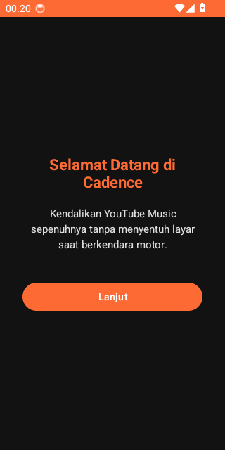

🇬🇧 English | 🇮🇩 [Bahasa Indonesia](README.id.md)

# Cadence 🎵🏍️ (Voice Control for YT Music on Motorcycles)

[](https://github.com/Seiyoouu/cadence/actions/workflows/build.yml)
[](https://github.com/Seiyoouu/cadence/releases)
[](https://developer.android.com)
[](https://www.gnu.org/licenses/gpl-3.0)

<p align="center">
  
</p>

---

## 🛑 The Problem

Changing songs or searching for music while riding a motorcycle is inconvenient and hazardous. Riders frequently have to pull over to the shoulder, take off riding gloves, unlock their phones, and fiddle with tiny touchscreen buttons in the glare. **Cadence** completely resolves this with 100% hands-free, screen-off voice control tailored for riders wearing helmets with Bluetooth TWS or intercoms.

---

## ✨ Features

- 🎙️ **Voice Control**: Play, pause, skip tracks, and search songs directly using your voice without touching the screen.
- 🗣️ **Bilingual Speech Engine**: Understands Bahasa Indonesia AND English commands simultaneously, regardless of your system language.
- 🔋 **Rider Mode (Bluetooth Automation)**: Automatically starts listening when your helmet TWS/intercom connects, and halts immediately upon disconnect to save battery.
- 📱 **Screen-Off Support**: Change and search songs even while your phone stays locked deep inside your jacket pocket.
- 🔓 **100% Rootless**: Safe and clean without root, Magisk, or Xposed. Interacts directly with YouTube Music Morphe via native MediaSession and deep links.
- 🎛️ **Physical TWS Fallback**: Physical media button support when wind noise at highway speeds is too loud for voice recognition.
- 📳 **Haptic & Spoken Feedback**: Distinct helmet vibration cues and optional Text-to-Speech (TTS) voice confirmation.

---

## 📱 Requirements

- **Android Version**: Android 8.0+ (API level 26 or higher).
- **Target Music App**: [YouTube Music Morphe](https://morphe.software) (`com.google.android.apps.youtube.music`).
- **Speech Service**: Google App / Speech Services (for Android native `SpeechRecognizer`).
- **Hardware**: Bluetooth TWS earbuds or helmet intercom with microphone.

---

## 🚀 Installation & Setup

1. **Download APK**: Grab the latest `app-release.apk` from the [Releases](https://github.com/Seiyoouu/cadence/releases) page.
2. **⚠️ Play Protect & Restricted Settings (Important)**:
   > **When sideloading Cadence**, Google Play Protect may show *"Unrecognized app"*. Tap **More details** → **Install anyway**.<br>
   > On **Android 13+**, if Notification Access appears greyed out or shows *"Restricted setting"*, go to your phone's **Settings → Apps → Cadence → tap the three dots (⋮) in the top-right corner → select "Allow restricted settings"** before enabling Notification Access. Full OEM details are documented in [docs/TROUBLESHOOTING.md](docs/TROUBLESHOOTING.md).
3. **Interactive Onboarding**: Launch Cadence and complete the 4-step setup (Notification Access, Microphone, Bluetooth).
4. **Hit the Road**: Connect your helmet TWS, say **"Hey Cade"** or **"Hai Cade"**, and command your music hands-free!

---

## 🧠 How It Works (Architecture)

```text
[Helmet / TWS Mic] ──> Wake Word ("Hey Cade" / VOSK) ──> Command STT (Android SpeechRecognizer)
                                                                    │
[Pocket / Screen-Off] ◄── Auto-Play Deep Link ◄── [Piped / Invidious API]
                                     │
                                     ▼
                          [YouTube Music Morphe]
```

1. **Wake Word Layer**: Continuous, battery-efficient offline listening via bundled VOSK acoustic engine (`assets/model-en/`).
2. **Command STT Layer**: One-shot multi-language recognition via Android's native `SpeechRecognizer` (supports offline language packs).
3. **Execution Layer**: Dispatches transport controls via `MediaSession` or resolves decentralized music search queries via Piped/Invidious deep links.

---

## 🤝 Contributing

Contributions, bug reports, and pull requests are warmly welcomed! Please check [CONTRIBUTING.md](CONTRIBUTING.md) for contribution guidelines, commit standards, and build instructions.

---

## 📜 License

Cadence is free and open-source software licensed under the [GNU General Public License v3.0](LICENSE).
